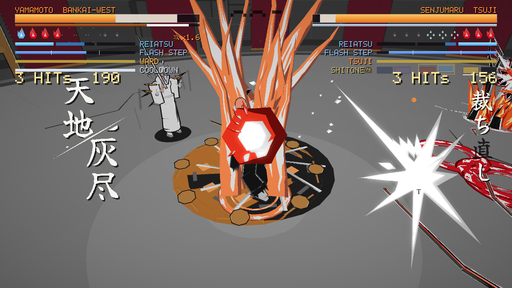
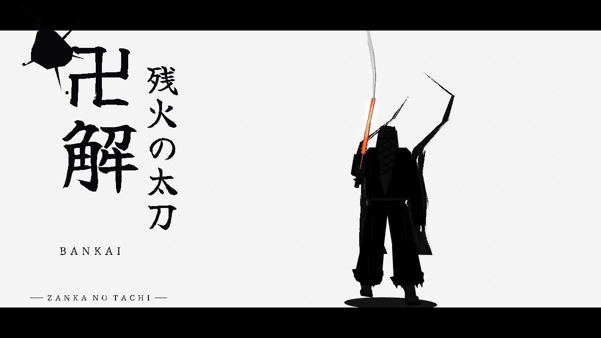
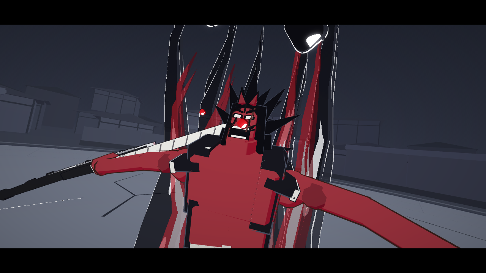
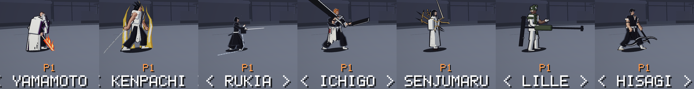

# SOUL DUEL

1 對 1 的 3D 競技場格鬥遊戲，玩法參考《BLEACH: Rebirth of Souls》，角色取自《千年血戰篇》（TYBW）。整款遊戲用 Common Lisp 寫成，先由 ECL 編成 C，再由 Emscripten 編成 WebAssembly，在瀏覽器裡執行；畫面透過 SDL3 的 SDL_GPU（WebGPU 後端）繪製。所有模型、動作、特效、字形、音效和配樂都是程式產生的，整個專案沒有任何美術或音訊素材檔。

**線上試玩：<https://toonnyy8.github.io/ai-cl-game-test/>**（電腦用 Chrome／Edge；手機直拿可以單手玩，也能「加到主畫面」當 App 離線開）。完整的遊戲說明在遊戲內的 MANUAL，原始檔是 [duel/web/manual.html](duel/web/manual.html)。



| 卍解・殘火の太刀 | 劍八的卍解 |
|---|---|
|  |  |

截圖由無頭 Chrome（SwiftShader 軟體算圖）在 1280×720 下自動拍攝。

這是**非商業的同人練習作品**（fan study）：角色與招式名稱應使用者要求使用，沒有使用原作動畫或遊戲的任何素材。

## 角色

七名角色，每人有自己的招式表、覺醒型態、角色量表、覺醒演出和電腦 AI。



| 角色 | 打法 | 覺醒 |
|---|---|---|
| 山本元柳齋重國 | 用火焰控場的老將，INFERNO 量表滿時變身限時的獄炎 | 卍解・殘火の太刀：在「東・旭日刃」與「西・殘日獄衣」兩個架式之間切換 |
| 更木劍八 | 吃招換招、越打越強的血戰狂人 | 呑め、野晒（一杯 片手 → 二杯 両手 → 三杯 飲み干せ）；三杯且魂魄剩 4 顆以下時，可以拿魂魄換卍解 |
| 朽木露琪亞 | 在對手身上疊霜再震碎，遠近都能打 | 絶対零度：−18 °C → −50 °C → −273 °C，越冷越強、也越走不動 |
| 黑崎一護 | 雙刀近身猛攻 | 血鎖の一護（KESSA），帶著分身圍毆 |
| 修多羅千手丸 | 先縫針、後引爆的裁縫師 | 卍解・娑闥迦羅骸刺絡辻：用織機在場上佈陣 |
| 利傑·巴羅 | 所有型態共用一個架勢：L 連段收資源、K 連段重擊、J 連段回復，SP2 一口氣花光 | 神の裁き（Jilliel）：近距的攻擊態與遠距的架勢 |
| 檜佐木修兵 | 始解風死：鎖鏈連著兩把鐮刀，2–6 公尺最強，風車擋飛行道具 | 卍解・風死絞縄：遠距靠鏈尖命中，首掛把兩人綁在一起 |

設計與數值的正本是 [docs/duel/DUEL_DESIGN.md](docs/duel/DUEL_DESIGN.md)，每個角色另有自己的設計文件（[docs/README.md](docs/README.md) 有索引）。

## 模式

| 模式 | 內容 |
|---|---|
| VS CPU | 對電腦，難度 EASY／NORMAL／HARD。電腦預設會學習你的習慣（見下方） |
| ENDLESS | 無限連戰：連續打電腦，對手越來越強，每個角色各存一筆最佳紀錄 |
| DANGAI 斷界行（製作中） | 10 關一輪的 roguelite：每關後選門、選獎勵卡（斬／守／瞬／靈／契／角色專屬的解），第 10 關是頭目 |
| PRACTICE | 對假人練習：假人可以站著、全防、被打中後才防、交給電腦，或在硬直結束時用 J1 反擊；可以鎖血、量表無限 |
| VS PLAYER | 兩人同機對戰（鍵盤左右兩半，或兩支手把） |
| CPU VS CPU | 看兩個電腦對打 |

## 規則速覽

- **勝負**：每人有 1300 點靈子（Reishi，血）和 9 顆魂魄（Konpaku，命），魂魄打光就輸，一場最長 300 秒。一般攻擊只扣靈子；要削魂魄只有兩種方法：對手靈子低於 30%（紅血）時用 **Kikon** 一次取走 2 顆（覺醒後 3 顆），或把靈子打到 0 的 **Soul Break**。
- **猜拳**：防禦 > J > I（抓技 Breaker）> 防禦。J 是快的輕攻擊，K 是慢而遠的重攻擊，J／K 組成最多三段的連段（J／K 之間最多換一次）。
- **步法**：Step、跑步，以及花瞬步量表瞬移到對手背後的 Hoho；抓準時機是完美 Hoho，觸發慢動作反擊。
- **量表**：靈壓 REIATSU（SP1／SP2 用，依招式種類與連段數回復）、瞬步 FLASH STEP（Hoho 與三種爆氣）、覺醒 AWAKEN（滿了按 P 覺醒）、防禦量表（扣光就 GUARD CRUSH），再加上每個角色自己的量表。
- **爆氣**：白色 SOUL REVERSE、藍色 BURST REVERSE（被連段時脫身）、橙色 CHAIN REVERSE（自己的連段打中後接下去），依狀態自動決定。

## 操作

移動是相對於對手的：往前就是朝對手，左右是繞著對手走。按鍵都可以在 CONTROLS 畫面自訂。

| 動作 | P1 鍵盤 | P2 鍵盤 | 手把 |
|---|---|---|---|
| 移動 | W A S D | 方向鍵 | 左搖桿／十字鍵 |
| J 輕攻擊／K 重攻擊／L 招牌技 | J／K／L | 數字鍵 1／2／3 | X／Y／B |
| U 防禦（按住）／I 抓技 Breaker | U／I | 數字鍵 4／5 | LB／RB |
| O Kikon 突進（按住＝Kikon） | O | 數字鍵 6 | RT |
| Step（按住＝跑） | Space | 數字鍵 0 | A |
| SP1／SP2／Hoho／爆氣 | Shift＋K／L／Space／J | Enter＋2／3／0／1 | LT＋Y／B／A／X |
| 覺醒 | P | 數字鍵 + | Back，或 LS＋RS |
| 暫停 | Esc | Esc | Start |

**手機**：直拿時自動變成單手模式。畫面右側是圓鈕，下半部是手勢區：點下半塊是 J、點上半塊是 K、按著不動是防禦、拖曳移動、撥動是 Step，往上撥是 Hoho。SETTINGS 可以切換慣用手、觸控靈敏度和 J／K 的分界。

**輔助**：SETTINGS 裡的 AUTO GUARD、AUTO COMBO、AUTO BREAK 會替新手防禦、接連段、破防。

## 會學習的電腦

電腦的 AI 由共用的判斷（[duel/lisp/ai.lisp](duel/lisp/ai.lisp)）加上每個角色自己的反應與連段路線組成，部分角色的風格是用 dream-rsi 在原生模擬裡搜尋出來的（[docs/guides/DREAM_RSI.zh-TW.md](docs/guides/DREAM_RSI.zh-TW.md)）。VS CPU 和 ENDLESS 的電腦會記下你在起身、擋完連段、揮空、對峙等情況下的習慣，照「防 > J > I > 防」準備對策；它不讀你的按鍵，有反應延遲，你一直輸它就少猜你一點。每個電腦角色的學習紀錄各自存在瀏覽器裡，SETTINGS 的 RESET LEARNING 可以清掉。細節在 [docs/duel/DUEL_AI_V2.md](docs/duel/DUEL_AI_V2.md) 與 [docs/duel/DUEL_LEARNING.md](docs/duel/DUEL_LEARNING.md)。

## 建置與執行

需要的工具鏈見下方「需求」。

```sh
./build.sh duel                              # 建出 dist/duel/
python3 -m http.server -d dist/duel 8000     # 用 Chrome 開 http://localhost:8000/
```

`dist/duel/` 是可以直接放到任何靜態伺服器的完整網站：`index.html`、`index.js`、`index.wasm`（約 9.8 MB）、說明書、PWA 的 manifest、service worker 和圖示。直接用 `file://` 開不行，瀏覽器不讓頁面這樣載入 wasm。第一次點擊或按鍵之後才會有聲音（瀏覽器的自動播放限制）。`tools/deploy-pages.sh` 把它發佈到 `gh-pages` 分支，也就是上面的線上版。

Lisp 編譯錯誤會印在終端機，完整記錄在 `build/duel/lisp.log`；錯誤行號指向串接後的 `build/duel/game-all.lisp`，每個原始檔開頭都有 `;;;; ---- duel/lisp/xxx.lisp` 這類標記方便對照。

其他建置目標：

```sh
./build.sh                        # RAVEN EDGE → dist/game/（見下方「同一個引擎上的其他作品」）
./build.sh examples/hello         # 最小的範例遊戲 → dist/hello/（教材從這裡開始）
./build.sh examples/engine-demo   # 引擎的算圖、特效、UI 展示 → dist/engine-demo/
./build.sh NAME a.lisp b.c        # 引擎加上指定檔案，建一個測試目標 dist/NAME/
GAME_OPT=-O1 ./build.sh duel      # 改 Lisp 產生的 C 的最佳化等級（預設 -O2）
EMCC_EXTRA="..." ./build.sh duel  # 額外的 emcc 連結參數
```

## 測試與平衡

模擬是決定性的：固定 60 Hz 步長、所有輸入（鍵盤、觸控、電腦）都走虛擬手把、亂數只在模擬步驟裡取。同一份原始碼也編成原生程式跑大量電腦對戰，結果和瀏覽器逐位元一致，所以平衡可以用統計來把關。

```sh
E=/media/8tsp/projects/ecl-24.5.10/ecl-emscripten-host/bin/ecl
$E --norc --load tests/duel-rules-test.lisp        # 規則與招式表（主機上跑，幾秒，檢查分在 tests/duel-rules/*.lisp）
$E --norc --load tests/duel-control-test.lisp      # 操作與指令表（另有 learn-test、input-test、touch-test、cine-test）
tools/pkgcheck.sh duel                             # 未定義、未 export、覆蓋引擎的函式
node tools/run.mjs dist/duel --fixed-dt 16.666667 --secs 8 --shot s.png   # 無頭 Chrome 冒煙測試，啟動記憶體超過 110 MB 也算失敗
python3 tools/simgate.py --summary                 # 原生模擬：每組配對的 K.O. 率與比賽時間中位數
python3 tools/assistgate.py                        # 亂按玩家在各種輔助設定下的勝率
python3 tools/aieval.py --char 2                   # 單一角色電腦 AI 的強度與風格分數
python3 tests/style-gates.py cvc dist/duel         # 固定種子的電腦對戰紀錄與參考檔逐行相同
python3 tests/style-gates.py looks BASE dist/duel  # 重構用：115 張畫面定格和改版前逐像素相同
```

`tools/run.mjs` 不需要安裝任何套件：它起一個小 HTTP 伺服器，用 DevTools 協定開無頭 Chrome（WebGPU 走 SwiftShader），把 console 輸出轉到終端機，照腳本在指定時間送出按鍵、觸控、`eval` 並拍截圖；頁面丟出 JS 例外時結束碼是 1。瀏覽器腳本由 `python3 tests/scripts/duel.py` 產生，腳本透過 `Module._debug_cmd(n)` 跳到指定情境。每一關的通過標準、除錯指令和效能數字在 [docs/duel/DUEL_GAMEPLAY.md](docs/duel/DUEL_GAMEPLAY.md)，怎麼把關見 skill `sim-balance-gates`。

## 資料夾

```
duel/        SOUL DUEL（DUEL 套件）
  lisp/        規則與調校（rules、tuning、kit、control、learn）、系統（fighter、combat、hazards、ai、assist、camera、
               hud、flow、endless、rogue……）、每個角色一組同前綴的檔案（yama*、ken*、rukia*、ichigo*、senjumaru*、
               barro*、hisagi*：招式、AI、動作、繪圖、過場、特效）、共用的畫風（body、brush、vfx、stage、cinema、glyphs、sounds）
  web/         HTML 外殼、說明書 manual.html、PWA（manifest、service worker、圖示）
  MANIFEST     原始檔的編譯順序，第一行 `# title: SOUL DUEL`
engine/      可重複使用的引擎（ENGINE 套件），不知道任何一款遊戲的存在
  lisp/        數學、命中判定、虛擬手把、觸控、平台、算圖、模型產生、UI、音訊、動畫、剛體角色、時間與固定步長、
               特效、過場導演、ECS、app（RUN-GAME）
  c/           engine.h（Lisp 呼叫的所有 C 函式）、main.c（啟動 ECL、GC、主迴圈）、platform.c、render.c、audio.c、rng.c
  shaders/     WGSL 著色器
  web/         共用的 HTML 外殼：向瀏覽器要 WebGPU 裝置、載入進度、錯誤畫面
game/        RAVEN EDGE（RAVEN 套件），第一款遊戲
examples/    hello/（最小的完整遊戲，教材的起點）、engine-demo/
tools/       建置、無頭測試、原生模擬與各種把關工具、部署、vendor 腳本
tests/       主機測試、瀏覽器腳本產生器、截圖與畫風檢查
skills/      九個 Claude skill（遊戲開發流程、平衡把關、畫風、角色設計與重做、招式模組、電腦 AI、動作風格）
docs/        文件，依主題分資料夾
vendor/      wasm 版 ECL、帶 WebGPU 後端的 SDL3、Dawn 的 emdawnwebgpu
babylon/     已停止的 TypeScript 移植版
```

每個建置目標是一個有 `MANIFEST` 的目錄：一行一個原始檔，依序編譯；`.lisp` 檔（引擎在前）串成一個編譯單元交給 ECL，`.c` 檔在連結時交給 emcc。為什麼這樣做，見教材第 1 步。

## 文件與學習路徑

- **[docs/guides/TUTORIAL.zh-TW.md](docs/guides/TUTORIAL.zh-TW.md)**：從建置、逐行讀 `examples/hello` 開始，依序看幀迴圈與 GC、ECS、純函式規則、事件、算圖，再用 SOUL DUEL 學虛擬手把、角色即資料、同時結算的命中、過場導演和決定性重播，最後有練習題。
- [docs/README.md](docs/README.md)：全部文件的索引，一行一份。
- [docs/DEVLOG.zh-TW.md](docs/DEVLOG.zh-TW.md)：開發紀錄，每個設計決定的來由。
- [docs/guides/PLAYBOOK.zh-TW.md](docs/guides/PLAYBOOK.zh-TW.md)、[docs/guides/CHARACTER_DESIGN.zh-TW.md](docs/guides/CHARACTER_DESIGN.zh-TW.md) 與 `skills/`：可重複使用的開發經驗。
- [AGENTS.md](AGENTS.md)：給 AI agent 的專案總覽與工作規則。

## 同一個引擎上的其他作品：RAVEN EDGE

引擎最早是為了 **RAVEN EDGE** 寫的：一款玩法參考《忍者外傳 4》的 3D 動作遊戲，在下著血色雨的頂樓連砍三波敵人，最後對上頭目 ENRA。它已經完成，現在很少改動。做 SOUL DUEL 的目的之一，是用第二種類型的遊戲找出引擎的缺口並補上，再把兩款遊戲都用得到的東西收回引擎（DEVLOG 第 14 節）。


建置用 `./build.sh`（輸出到 `dist/game/`）。玩法、操作和測試方法見 [docs/raven-edge/RAVEN_EDGE.zh-TW.md](docs/raven-edge/RAVEN_EDGE.zh-TW.md)，設計與數值見 [docs/raven-edge/GAME_DESIGN.md](docs/raven-edge/GAME_DESIGN.md)。

## 需求

**瀏覽器**：支援 WebGPU 的瀏覽器，例如 Chrome／Edge 113 以上（Windows、macOS、ChromeOS、Android；Linux 視顯示卡和驅動而定，可試 `google-chrome --enable-unsafe-webgpu --enable-features=Vulkan`）、Safari 26 以上、Windows 上的 Firefox 141 以上。不支援時頁面會顯示「WEBGPU UNAVAILABLE」。

**建置工具鏈**：以下是這台機器上實際使用的版本。路徑寫死在 `build.sh`、`tools/build.lisp` 與 `tools/pkgcheck.sh`，可以用環境變數覆寫；`tools/setup-cloud-env.sh` 能在全新的雲端容器裡把整套工具鏈重建在這些路徑（約 15 分鐘）。

| 元件 | 版本／位置 | 用途 |
|---|---|---|
| ECL host 版 | ECL 24.5.10，32 位元 i386 版，裝在 `/media/8tsp/projects/ecl-24.5.10/ecl-emscripten-host`（`ECL_HOST` 可覆寫） | 在主機上把 Lisp 編成 C，C 編譯器指定為 `emcc`；也用來跑主機測試 |
| ECL wasm32 交叉編譯版 | 同一份原始碼樹，`build/` 目錄是 `--host=wasm32-unknown-emscripten` 的建置結果 | 提供 `libecl`、Boehm GC、GMP 的 wasm 版本 |
| Emscripten | emsdk 4.0.12，位於 `/media/8tsp/projects/emsdk`（`EMSDK_DIR` 可覆寫） | 編譯、連結成 wasm |
| SDL3 | SDL PR #16020（實驗性的 SDL_GPU WebGPU 後端，尚未合併）固定在某個 commit，加上本地修正 `vendor/sdl3-webgpu.patch`，建好的靜態庫在 `vendor/sdl3-webgpu/` | 視窗、SDL_GPU 算圖、輸入、音訊 |
| emdawnwebgpu | Dawn `v20260917.220300` 的套件，放在 `vendor/emdawn/`（emsdk 4.0.12 內建的版本太舊，列舉值和 SDL 的 `webgpu.h` 對不上） | WebGPU 的 C API 實作 |
| Node.js | ≥ 22（本機 v22.18.0） | 執行 `tools/run.mjs`（用到內建的 `WebSocket`） |
| Google Chrome | 系統上的 `google-chrome` | 無頭測試 |
| Python 3 | 任意版本 | 產生測試腳本、原生模擬的把關工具、`python3 -m http.server` |

### vendor/ecl 從哪來

`vendor/ecl/` 放的是 wasm32 版 ECL 的靜態函式庫和標頭檔，已經在專案裡，一般不需要重做。要重新產生的話：

```sh
ECL_SRC=/media/8tsp/projects/ecl-24.5.10 ./tools/vendor-ecl.sh
```

這支腳本會把交叉建置產生的 `libeclmin.a`（C 核心）、`liblsp.a`（編譯好的 Lisp 核心）和 `c/all_symbols2.o` 合成一個 `libecl.a`，再複製 `libeclgc.a`、`libeclgmp.a` 以及 `ecl-emscripten/ecl` 的標頭檔。交叉建置目錄裡雖然也有 `libecl.so`，但那是 Emscripten 的 SIDE_MODULE（帶 `dylink.0` 區段），不能拿來靜態連結。

### vendor/sdl3-webgpu 與 vendor/emdawn 從哪來

```sh
./tools/vendor-sdl3-webgpu.sh
```

腳本會抓 SDL PR #16020 的固定 commit、套用 `vendor/sdl3-webgpu.patch`、用 emcmake 建出不含 OpenGL／GLES／SDL_Renderer 的靜態 SDL3，再下載對應版本的 emdawnwebgpu。patch 裡每一處修正都標了 `raven-edge patch:` 註解，原因寫在 [docs/DEVLOG.zh-TW.md](docs/DEVLOG.zh-TW.md) 第 11 節。注意：SDL 專案不接受 AI 產生的程式碼貢獻，這些修正只供本專案使用，要回報上游必須由人自行確認並重寫。

### 從頭建置 ECL 交叉編譯工具鏈

步驟照 ECL 原始碼裡 `INSTALL` 的「Cross-compile for the WASM platform」一節，重點如下：

```sh
cd ecl-24.5.10

# 1. 32 位元的 host ECL（wasm32 是 32 位元，host 的 fixnum 大小必須一致）
./configure ABI=32 CFLAGS="-m32 -g -O2" LDFLAGS="-m32 -g -O2" \
            --prefix=`pwd`/ecl-emscripten-host --disable-threads
make -j16 && make install
rm -rf build/

# 2. 啟用 emsdk，告訴交叉建置要用哪個 host ECL
source /path/to/emsdk/emsdk_env.sh
export ECL_TO_RUN=`pwd`/ecl-emscripten-host/bin/ecl

# 3. 交叉編譯 wasm32 核心
emconfigure ./configure \
            --host=wasm32-unknown-emscripten \
            --build=x86_64-pc-linux-gnu \
            --with-cross-config=`pwd`/src/util/wasm32-unknown-emscripten.cross_config \
            --prefix=`pwd`/ecl-emscripten \
            --with-tcp=no --with-cmp=no
emmake make && emmake make install
```

本機那份交叉建置最後的 `CFLAGS` 是 `-DECL_C_COMPATIBLE_VARIADIC_DISPATCH -O0 -fPIC`（見 `build/config.log`）。其中 `-DECL_C_COMPATIBLE_VARIADIC_DISPATCH` 很重要：遊戲這邊編譯時也必須加同一個旗標，`build.sh` 和 `tools/build.lisp` 都已經加了。兩邊不一致的話，`struct ecl_cfun` 的欄位配置會對不上，執行時會在 `call_indirect` 直接 trap。ECL 的 `INSTALL` 說測試過的是 emsdk 3.1.41，我們用 4.0.12 也能建。

## 致謝與限制

建立在這些專案之上：[ECL](https://ecl.common-lisp.dev/)（Embeddable Common Lisp）、[Emscripten](https://emscripten.org/)、[SDL3](https://libsdl.org/) 與其 SDL_GPU WebGPU 後端草稿（PR #16020）、Google Dawn 的 emdawnwebgpu、Boehm GC、GMP。SOUL DUEL 是參考《BLEACH: Rebirth of Souls》的非商業同人練習作品，角色與招式名稱應使用者要求使用，素材全部由程式產生。RAVEN EDGE 的玩法結構參考 Team NINJA 的《忍者外傳 4》，但沒有使用該作的任何名稱、角色或素材。這個專案由多個 AI agent 分工完成，流程記錄在 DEVLOG 第 9 節與第 14 節。

已知限制：

- 自動測試的畫面都在 SwiftShader 上拍攝與比對；手感、節奏和實體 GPU 上的畫面要靠真人試玩確認。
- 依賴尚未合併的 SDL WebGPU 後端分支和本地 patch。
- `libecl` 是 `-O0` 建的，ECL 執行期函式跑的是沒最佳化的程式碼。
- 記憶體回收只在幀與幀之間進行，每次是一次完整回收（約 20 毫秒）；每幀配置壓到約 3 KB 後，大約兩分多鐘才發生一次（DEVLOG 第 404–405 節）。
